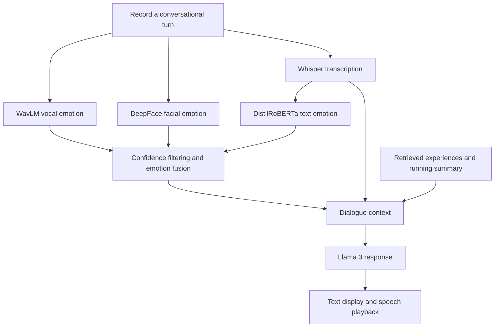

# Conversational Agent with Emotional Memory

A voice-based conversational agent that combines speech, vocal expression, and facial cues to guide its responses. It runs Llama 3 locally through Ollama and uses emotional memory to connect the current conversation with experiences the user described earlier.

The main implementation, [master_fusion.py](input_model/master_fusion.py), brings together recording, emotion recognition, confidence-based fusion, memory retrieval, response generation, and speech playback in a single conversation loop.

**Two versions for comparison**

We developed two versions to investigate whether adding an emotional memory architecture changes users' perceived empathy and rapport with the agent.

| Feature | Basic version | Version with emotional memory |
| --- | --- | --- |
| Entry point | [master_fusion_basic.py](input_model/master_fusion_basic.py) | [master_fusion.py](input_model/master_fusion.py) |
| Speech, text, and facial emotion processing | Yes | Yes |
| Confidence filtering and emotion fusion | Yes | Yes |
| Recent conversation context | Yes | Yes |
| Retrieval of stored emotional experiences | No | ChromaDB semantic search |
| Running summary of the user's story | No | Updated in the background every three processed turns |
| Comparison of past and current emotions | No | Used to guide follow-up questions |

The basic version is the baseline without the additional memory architecture. Both versions retain a short window of recent messages to support a coherent exchange. The more sophisticated version adds stored experiences and a running narrative summary to preserve context beyond that window.

**How master_fusion works**



1. **Capture a turn.** Record microphone audio at 16 kHz while sampling webcam frames approximately once per second.
2. **Estimate emotional signals.** Transcribe speech, classify the text and voice, and average facial emotion scores across processed frames. Labels are aligned to anger, disgust, fear, joy, sadness, surprise, and neutral.
3. **Filter and combine.** Remove weak signals, check agreement between the remaining sources, and combine agreeing distributions using confidence-based weights. Conflicting signals or insufficient evidence trigger a clarification question.
4. **Retrieve context.** Search stored experiences for a similar topic and compare its previous emotional distribution with the current one. Add relevant memory and the running summary to the dialogue context.
5. **Respond and update memory.** Generate a reply with Llama 3, synthesize speech, store resolved emotional experiences, and periodically update the narrative summary. The terminal also prints diagnostic scores and processing times.

Emotion labels are model estimates used to shape the conversation. The comparison study evaluates how users experience the resulting interaction.

**Models and tools**

| Role | Implementation |
| --- | --- |
| Speech transcription | Whisper — `openai/whisper-small.en` |
| Text emotion | DistilRoBERTa — `j-hartmann/emotion-english-distilroberta-base` |
| Vocal emotion | WavLM — `3loi/SER-Odyssey-Baseline-WavLM-Categorical-Attributes` |
| Facial emotion | DeepFace |
| Dialogue generation | Llama 3 through Ollama's local chat API |
| Emotional memory | ChromaDB and an LLM-generated running summary |
| Speech output | Coqui TTS — `tts_models/en/ljspeech/vits`, with `ffplay` for playback |
| Interface | Streamlit, with simple and debug views |

**Set up locally**

You will need a microphone, webcam, and speakers or headphones. Run the agent on the computer connected to those devices; the Streamlit interface controls recording on that computer.

Install these prerequisites:

- **Python 3.10** for the setup below. The repository pins older dependencies, including [Coqui TTS 0.14.2](https://pypi.org/project/TTS/0.14.2/), which provides Python 3.10 wheels.
- **[Ollama](https://docs.ollama.com/quickstart)** for local dialogue generation.
- **[FFmpeg](https://ffmpeg.org/download.html)** with `ffplay` available on your `PATH` for speech playback.
- **PortAudio** if required by your platform for microphone input; see the [sounddevice installation guide](https://python-sounddevice.readthedocs.io/en/latest/installation.html).

The following commands use a macOS/Linux shell. Start in the repository root and create the environment there so the session launchers can find it:

```bash
python3.10 -m venv .venv
source .venv/bin/activate
python -m pip install -r requirements.txt
```

Start Ollama through its application, or run `ollama serve` in a separate terminal if the service is not already running. Then download the [Llama 3 model](https://ollama.com/library/llama3):

```bash
ollama pull llama3
```

The agent connects to `http://localhost:11434/api/chat`. Keep Ollama running while using the project. See the [Ollama CLI reference](https://docs.ollama.com/cli) for service and model commands.

The first launch downloads additional model weights and can take substantially longer than later launches. Allow microphone and camera access when your operating system requests it.

**Run a conversation**

With the virtual environment active, run the full version from the repository root:

```bash
python input_model/master_fusion.py
```

To run the basic comparison version instead:

```bash
python input_model/master_fusion_basic.py
```

Once the models have loaded:

1. Press **Enter** to start speaking.
2. Press **Enter** again to finish your turn.
3. Wait for the agent to process the input and speak its response.
4. Repeat, or type **`q`** at the next start prompt to end the conversation with a closing response.

**Use the web interface**

For the simple conversation view, run from the repository root:

```bash
python -m streamlit run input_model/ui_simple.py
```

For emotion scores, confidence decisions, the running summary, and processing times:

```bash
python -m streamlit run input_model/ui_debug.py
```

Open **Session controls → Launch agent**, wait until the agent is ready, then use **Start speaking**, **Stop speaking**, and **End conversation**.

Both interfaces launch `master_fusion.py` by default. To use the basic version, set `TARGET_SCRIPT = "master_fusion_basic.py"` near the top of the UI file you are running. The simple/debug choice controls the presentation; `TARGET_SCRIPT` selects the experimental condition.

**Record a study session**

The session launchers generate a random participant ID, capture terminal output, and copy recordings and debug frames into a session directory after the conversation finishes. The full version also copies the ChromaDB database.

Run one of these commands from the repository root:

```bash
bash run_session.sh
```

```bash
bash run_session_basic.sh
```

Exports are stored in `sessions/<participant_id>/` and `sessions_basic/<participant_id>/`, respectively. These launchers require Bash and OpenSSL. The web interfaces use them when Bash is available.

Each launcher clears the working recordings and debug frames before starting; the full launcher also clears the working memory database. Previously exported session directories are retained. Run one session at a time.

Direct Python launches reuse `input_model/chroma_db/`. Audio and frames are saved under `input_model/audio_recordings/` and `input_model/debug_frames/`. If a running summary is available, the full agent writes `final_summary_session_<timestamp>.json` on normal exit. This file is saved separately from the session export, in the repository root for the direct commands above or in `input_model/` when using a launcher.

**Find your way around the code**

| Location | Purpose |
| --- | --- |
| [input_model/master_fusion.py](input_model/master_fusion.py) | Main conversation loop and emotional memory architecture |
| [input_model/master_fusion_basic.py](input_model/master_fusion_basic.py) | Baseline used for comparison |
| [confidence.py](input_model/confidence.py), [agreement.py](input_model/agreement.py), [fusion.py](input_model/fusion.py) | Signal filtering, agreement decisions, and weighted fusion |
| [input_model/database.py](input_model/database.py) | Storage and retrieval of emotional experiences |
| [input_model/prosodic_modality/wavlm_cat.py](input_model/prosodic_modality/wavlm_cat.py) | Vocal emotion model adapter |
| [ui_simple.py](input_model/ui_simple.py), [ui_debug.py](input_model/ui_debug.py) | Conversation and diagnostic interfaces |
| [statistical_analysis/](statistical_analysis/) | Comparison notebook and study figures |
| [modalities_experiments/](modalities_experiments/) | Earlier experiments with individual components |

The [analysis notebook](statistical_analysis/statistical_analysis.ipynb) examines perceived empathy and rapport using the RoPE and CCR questionnaires.
